# nnct-news — Bản tin công nghệ buổi sáng qua Telegram

> Trạng thái: design v0.4 (2026-10-14). Chưa có code.
>
> Lịch sử thay đổi:
> - **v0.4**: chọn model theo rate limit free tier thật trong AI Studio: triage → 3.1 Flash-Lite, tóm tắt → 3.5 Flash-Lite, thêm limiter theo token/phút, dùng project Google riêng.
> - v0.3: chạy **$0 hoàn toàn** (Gemini free tier, không gắn billing); pipeline dạng hàng đợi theo trạng thái + throttle để chịu được rate limit; tóm tắt dài, dễ hiểu; **mỗi tin 1 message**; bỏ giới hạn thời gian đọc; digest có sẵn **trước 8:00**.
> - v0.2: chuyển sang Gemini API, ingest 2h/lần, 20 tin/ngày, bỏ X và Facebook, backend chuyển sang Encore Go.
>
> Mục tiêu: mỗi sáng nhận **20 tin** đáng đọc nhất (AI, tech thế giới, tech VN, dev tools), có sẵn trước 8:00. Mỗi tin là một message có tóm tắt tiếng Việt đủ để hình dung nội dung, kèm nút mở bài gốc. Chi phí **$0**.

---

## 1. Yêu cầu

| # | Yêu cầu | Đo bằng |
|---|---|---|
| R1 | Gom tin từ nhiều nguồn: báo lớn VN và thế giới, Hacker News, Reddit, blog của các lab AI | số nguồn active trong `sources.yaml` |
| R2 | Lọc tin loãng, chỉ giữ chủ đề mình quan tâm | tỉ lệ 👎 / tổng tin trong digest < 20% |
| R3 | Xác định tin "nóng" (nhiều nguồn cùng đưa, engagement cao) | có `hot_score` kèm lý do |
| R4 | Tóm tắt tiếng Việt **dễ hiểu, đủ ý** (bối cảnh, chi tiết chính, ý nghĩa), không bịa | tóm tắt chỉ dựa trên text bài gốc đã fetch |
| R5 | Digest có trong Telegram **trước 8:00 ICT**, mỗi tin 1 message, có nút mở bài gốc | job chạy mỗi ngày, idempotent, resume được |
| R6 | Học dần sở thích từ 👍 / 👎 / click | trọng số topic/source thay đổi theo feedback |
| R7 | **Chi phí $0** | không gắn billing ở cả Google lẫn Encore |

Ngoài phạm vi: UI web, nhiều user, public channel, X/Twitter, Facebook.

---

## 2. Kiến trúc tổng quan

```mermaid
flowchart LR
  subgraph Sources
    RSS[RSS báo VN + quốc tế]
    HN[Hacker News API]
    RD[Reddit API]
    BLOG[Blog lab AI / RSS]
  end

  subgraph "Cron ingest: mỗi 2 giờ"
    F[Fetch + normalize] --> D1[Dedupe URL/title]
    D1 --> Q[(items: state = new)]
    Q --> T[Triage - Gemini 3.1 Flash-Lite]
    T --> E[Embed - Gemini Embedding 2]
    E --> C[Cluster theo sự kiện<br/>pgvector, cửa sổ 48h]
    C --> S[Cập nhật hot_score]
  end

  subgraph "Cron digest: 06:xx, chạy bù 07:xx"
    R[Chọn top 20<br/>có ràng buộc đa dạng] --> X2[Fetch full text bài gốc]
    X2 --> SUM[Tóm tắt VN - Gemini 3.5 Flash-Lite]
    SUM --> TG[Gửi Telegram<br/>1 tin = 1 message]
  end

  GEM{{Gemini client<br/>throttle + fallback model}}
  T -.-> GEM
  E -.-> GEM
  SUM -.-> GEM

  Sources --> F
  S --> DB[(Postgres + pgvector<br/>Encore Cloud)]
  DB --> R
  TG --> U((Mình))
  U -- "👍 👎 🔖 / click" --> WH[Webhook bot] --> DB
```



Hai nhịp tách riêng:

- **Ingest 2 giờ/lần** → cluster lớn dần khi nhiều báo cùng đưa một sự kiện, engagement (HN points, Reddit upvotes) có thời gian tích luỹ. Đây là tín hiệu "nóng".
- **Digest 1 lần/ngày** → chỉ tóm tắt 20 tin được chọn.

---

## 3. Thiết kế để chạy free: hàng đợi theo trạng thái + throttle

Free tier của Gemini có rate limit (RPM/TPM/RPD), Google có thể đổi bất cứ lúc nào và không cam kết SLA. Vì vậy pipeline **không giả định gọi API lúc nào cũng thành công**. Ba nguyên tắc:

1. **Mỗi bước là một hàng đợi theo trạng thái trong DB.** Item đi qua các state `new → triaged → embedded → clustered` (hoặc `dropped`). Mỗi lần cron chạy chỉ xử lý những gì còn dang dở, trong giới hạn budget của lượt đó. Lượt này bị 429 thì phần còn lại tự được xử lý ở lượt sau, không mất gì.
2. **Một Gemini client dùng chung**, có:
   - **Throttle** theo từng model, cả theo request lẫn theo token/phút, cấu hình theo rate limit free tier thật (§9.3). Lượng việc mỗi ngày rất ít nên chậm cũng không sao.
   - **Retry 429/5xx** với exponential backoff + jitter (15s → 30s → 60s → 120s), tôn trọng `retryDelay` nếu API trả về.
   - **Đếm request/ngày** theo model trong DB (bảng `llm_usage`, reset theo nửa đêm giờ Pacific như quota RPD), dừng trước khi chạm trần cấu hình (`GEMINI_DAILY_BUDGET`).
   - **Fallback chain**: một model hết quota trong ngày hoặc bị gỡ thì chuyển sang model kế tiếp (§9.2).
3. **Luôn có đường lui**: tóm tắt thất bại thì vẫn gửi tin với tiêu đề + snippet + link, đánh dấu ⚠️ "chưa tóm tắt được".

Số request ước tính mỗi ngày (~1.000 item mới/ngày, ước tính chưa đo):

| Bước | Cách gom | Request/ngày |
|---|---|---|
| Bước | Cách gom | Request/ngày | Free RPD của model |
|---|---|---|---|
| Triage | 40 item/request | ~25–30 | 500 (3.1 Flash-Lite) |
| Embedding | batch ≤ 80 text/request, chỉ item đã qua triage | ~10–25 | 1.000 (Embedding 2) |
| Tóm tắt | 1 cluster/request | 20 (+ retry, `/more`) | 500 (3.5 Flash-Lite) |

Dư quota rất nhiều. Ràng buộc thật sự là **TPM** (token/phút), nhất là embedding (30K) — xem §9.3. Lượt ingest (~85 item → 3 triage + 1–2 embed) mất dưới 1 phút; lượt digest (20 tóm tắt, ~25K token mỗi cái, limiter token giữ < 200K/phút) mất ~3–4 phút.

---

## 4. Nguồn tin

Nguyên tắc: **chỉ dùng RSS và API chính thức, miễn phí**, không scrape. X và Facebook bỏ hẳn.

| Nhóm | Nguồn | Cách lấy | Ghi chú |
|---|---|---|---|
| Tech VN | VnExpress Số hoá, Tuổi Trẻ Nhịp sống số, Thanh Niên Công nghệ, VietnamNet ICT, Genk, Znews Công nghệ | RSS | URL feed từng trang **not verified**, kiểm khi setup |
| Tech thế giới | TechCrunch, The Verge, Ars Technica, Wired, MIT Technology Review, Reuters Technology | RSS | Trang paywall: chỉ dùng title + snippet |
| AI | Blog OpenAI, Anthropic, Google DeepMind, Meta AI, Hugging Face; HF Daily Papers | RSS | Không lấy arXiv thô |
| Cộng đồng | Hacker News (Firebase API: top/best stories), Reddit (r/MachineLearning, r/LocalLLaMA, r/programming) | API | Engagement dùng cho `hot_score`. Điều khoản Reddit API cho dự án cá nhân: **not verified** |
| Dev | GitHub Blog, release của Go/Next.js/Rust/Tauri/Encore | RSS / GitHub Releases Atom | |

Khai báo trong `config/sources.yaml` (embed vào binary bằng `//go:embed`):

```yaml
- id: vnexpress-sohoa
  kind: rss
  url: https://vnexpress.net/rss/so-hoa.rss   # not verified
  lang: vi
  section: vn
  weight: 1.0          # độ uy tín, feedback sẽ chỉnh dần
- id: hn-top
  kind: hn
  min_points: 100
  section: global
  weight: 1.2
```

---

## 5. Pipeline chi tiết

### 5.1 Fetch + normalize (cron ingest, mỗi 2 giờ)

- Dùng `ETag` / `If-Modified-Since`, timeout 10s/nguồn, chạy song song có giới hạn (`errgroup.SetLimit(8)`).
- Chuẩn hoá về `Item { URLCanonical, Title, Snippet, Lang, PublishedAt, SourceID, Engagement }`, `state = new`.
- Canonical URL: bỏ `utm_*`, `fbclid`, `amp`, `m.`, trailing slash.
- Bỏ item cũ hơn 48h.
- Nguồn lỗi 5 lần liên tiếp → tự `enabled=false` + nhắn cảnh báo vào Telegram.

### 5.2 Dedupe

1. `url_canonical` unique trong DB (`ON CONFLICT DO NOTHING`).
2. Hash của title đã normalize (lowercase, bỏ dấu câu) trong 48h.

### 5.3 Triage — Gemini 3.1 Flash-Lite

Lấy item `state = new`, gom ~40 item/request (title + snippet + tên nguồn), thinking thấp nhất, structured output (JSON schema):

```json
{
  "id": "…",
  "topics": ["ai-models", "dev-tools"],
  "relevance": 0,
  "kind": "news|opinion|tutorial|pr|deal|clickbait",
  "title_vi": "…"
}
```

`relevance` là số nguyên 0–10. `relevance < 4` hoặc `kind ∈ {pr, deal, clickbait}` → `state = dropped` (vẫn lưu để debug), còn lại → `triaged`.

Profile sở thích (`config/profile.yaml`), mình tự sửa:

```yaml
topics:            # trọng số ban đầu, feedback sẽ chỉnh (danh sách đầy đủ + định nghĩa: news/brain/prompts/triage.txt)
  ai-models: 1.0        # model mới, benchmark, lab AI
  ai-engineering: 1.0   # RAG, inference, eval, tooling
  agents: 1.0
  research: 0.8
  backend: 0.8
  cloud: 0.7
  architecture: 0.8
  system-design: 0.8
  software-engineering: 0.8
  algorithms: 0.6
  dev-tools: 0.8
  security: 0.6
  big-tech: 0.6
  startup: 0.7
  vn: 0.9               # tin về Việt Nam; báo VN đưa tin quốc tế không tính
  hardware-chips: 0.5
  policy-regulation: 0.5
  technology: 0.5
muted_keywords: [crypto airdrop, giveaway, khuyến mãi, review điện thoại]
boosted_keywords: [Claude, Gemini, Anthropic, Next.js, Rust, Tauri, Encore, pgvector]
```

### 5.4 Embed + cluster theo sự kiện

- Lấy item `state = triaged`, embed `title + snippet` bằng **Gemini Embedding 2**. Model đa ngôn ngữ nên tin VN và EN về cùng sự kiện có thể rơi chung cluster. Chất lượng tiếng Việt **not verified**, cần test trên data thật.
- Giảm chiều xuống 768 nếu API cho chọn output dimensionality (**not verified** với Embedding 2), lưu kiểu `halfvec(768)` để tiết kiệm dung lượng.
- Item mới: tìm cluster gần nhất trong 48h, cosine ≥ ngưỡng (bắt đầu 0.82, tune bằng tay) → gán vào; không thì tạo cluster mới. Sau đó `state = clustered`.
- Cluster giữ `n_sources` (số nguồn **khác nhau**), `first_seen`, `max_engagement`.

### 5.5 Hot score

Tính lại cho cluster mỗi khi có item mới:

```
hot = 1.5 · ln(1 + n_sources)          # nhiều báo cùng đưa = nóng
    + 1.0 · engagement_norm            # HN points / Reddit upvotes, chuẩn hoá theo percentile của từng nguồn
    + 0.8 · avg(source.weight)
    + 1.2 · relevance/10 · topic_weight
    + 0.3 · boosted_keyword_hit
    − 0.5 · age_hours/24               # decay
```

Hệ số là điểm khởi đầu. Cột `hot_reason` lưu từng thành phần để debug "sao tin này lên top".

### 5.6 Chọn tin cho digest

- Đầu job digest chạy ingest thêm một lượt để có tin mới nhất.
- Lấy cluster có `hot` cao nhất, chưa từng gửi. Cluster đã gửi chỉ gửi lại khi `n_sources` tăng ≥ 3, kèm nhãn 🔄 Cập nhật.
- Ràng buộc đa dạng: tổng **20 tin**; mỗi section tối đa 7; **ít nhất 3 tin VN**; mỗi topic tối đa 4.
- Danh sách 20 tin được ghi vào `digest_items` **trước khi** tóm tắt, mỗi dòng có `state`: `selected → summarized → sent`. Nhờ vậy job chết giữa chừng thì lượt sau chạy tiếp đúng chỗ.

### 5.7 Tóm tắt — Gemini 3.5 Flash-Lite

Input: full text 1–3 bài trong cluster (nguồn uy tín nhất + 1 nguồn VN nếu có), trích bằng `go-readability`, cắt tối đa ~8K token/bài. Paywall hoặc lỗi → dùng snippet và đánh dấu `low_context`.

Output (structured output, JSON schema). Mục tiêu là đọc xong hình dung được chuyện gì đã xảy ra mà không cần mở bài:

```json
{
  "headline_vi": "≤ 100 ký tự, nói thẳng sự kiện",
  "context": "3–4 câu: bối cảnh + chuyện gì xảy ra, viết cho người chưa biết gì về chủ đề",
  "key_points": ["3–5 ý, mỗi ý 1 câu: con số, tính năng, ai liên quan, mốc thời gian"],
  "why_it_matters": "1–2 câu: ảnh hưởng tới dev / người làm AI / thị trường VN",
  "glossary": [{"term": "RAG", "explain": "1 câu giải thích dễ hiểu"}],
  "caveats": "nếu các nguồn mâu thuẫn hoặc thông tin chưa xác nhận; rỗng nếu không có",
  "low_context": false
}
```

Prompt yêu cầu:

- Tiếng Việt tự nhiên, dễ hiểu, giữ nguyên thuật ngữ kỹ thuật tiếng Anh; thuật ngữ khó thì giải thích trong `glossary` (tối đa 2).
- **Chỉ dùng thông tin trong text được cung cấp**, không thêm kiến thức ngoài. Thiếu thông tin thì viết ngắn lại, không độn.
- Độ dài tổng khoảng 120–200 từ. Đây là hướng dẫn, không phải giới hạn cứng.

Tóm tắt xong tin nào thì lưu ngay vào `digest_items` (`state = summarized`). Lỗi hết retry và hết fallback model → giữ `selected`, lượt chạy bù 07:xx thử lại. Vẫn lỗi thì gửi dạng fallback (§3).

---

## 6. Trải nghiệm Telegram

### 6.1 Format: mỗi tin 1 message

Gửi 1 message header rồi 20 message tin, theo thứ tự hot giảm dần. Tất cả **silent** (`disable_notification: true`), tắt link preview. Khoảng cách giữa các message ≥ 1,1 giây vì Telegram khuyến nghị không gửi quá 1 message/giây trong một chat ([Bots FAQ](https://core.telegram.org/bots/faq)).

Header:

```
☀️ Bản tin thứ Năm 15/10 — 20 tin
🔥 Nóng (3) · 🤖 AI (6) · 🌍 Tech (6) · 🇻🇳 VN (5)
```

Một tin (parse mode HTML):

```
🔥 #1 · 🤖 AI · 7 nguồn

<b>Tiêu đề tiếng Việt của tin</b>

Bối cảnh và chuyện gì xảy ra, 3–4 câu…

🔍 Điểm chính
• Ý 1
• Ý 2
• Ý 3

💡 Vì sao đáng quan tâm: …

🧩 <i>RAG</i>: giải thích 1 câu.

📰 TechCrunch · The Verge · VnExpress
```

Inline keyboard:

```
[📖 Đọc bài gốc]  [📚 Nguồn khác]
[👍]  [👎]  [🔖 Lưu]
```

- `📖 Đọc bài gốc` là URL button trỏ tới `/r/:clusterID`, server 302 sang bài gốc → ghi nhận click (tín hiệu sở thích mạnh nhất, chỉ là data của chính mình).
- `📚 Nguồn khác` → callback, bot reply danh sách link các báo khác trong cluster.
- Bấm 👍/👎/🔖 → `editMessageReplyMarkup` đổi nút đã bấm thành ✅.
- Một tin dài nhất ~1.500 ký tự, dư so với giới hạn 4.096 ký tự/message. Renderer vẫn kiểm độ dài và cắt `key_points` nếu vượt.

### 6.2 Lệnh bot

| Lệnh | Việc |
|---|---|
| `/today` | Gửi lại digest hôm nay |
| `/more ai` | Thêm 5 tin tiếp theo của section/topic (tóm tắt on-demand, tính vào budget) |
| `/saved` | Danh sách tin đã 🔖 |
| `/mute <từ khoá>` / `/boost <từ khoá>` | Sửa profile nhanh |
| `/status` | Tình trạng nguồn, request Gemini đã dùng hôm nay, dung lượng DB |
| `/search <từ khoá>` | Tìm trong 7 ngày gần nhất |

### 6.3 Học sở thích

- 👍 / click → `topic_weight += 0.05`, `source.weight += 0.02` (kẹp trong [0.2, 2.0]).
- 👎 → trừ gấp đôi. 3 lần 👎 cùng một keyword → bot gợi ý `/mute`.
- Phase 2: "interest vector" = trung bình embedding các tin 👍/click, cluster nào gần thì được cộng điểm.

---

## 7. Hạ tầng: Encore Go + Encore Cloud (free)

### 7.1 Encore Cloud: $0

Kiểm ngày 2026-10-14 trên trang chính thức:

- Gói **Starter miễn phí**, "free forever, with no time limit", gồm 2 dev environment trên Encore Cloud và 1M tracing events/tháng ([encore.dev/pricing](https://encore.dev/pricing)).
- Fair Use trên Encore Cloud (tính theo app): 100.000 request/ngày, 100.000 Pub/Sub message/ngày, **1 GB database**, 1 GB object storage, **cron tối đa 1 lần/giờ** ([pricing](https://encore.dev/pricing)).
- Encore Cloud dành cho "development environments and limited scale professional use that does not require specific SLAs" ([Plans & Billing](https://encore.dev/docs/about/billing)). Bot cá nhân nằm gọn trong phạm vi này.
- Compute/egress: trang pricing không ghi giới hạn → **not verified**.

### 7.2 Cron

Theo [docs cron Go](https://encore.dev/docs/go/primitives/cron-jobs): free tier tối đa 1 lần/giờ, phút chạy bị random, giờ tính theo UTC, không chạy ở local dev, endpoint có thể bị gọi nhiều lần nên phải idempotent.

| Job | Config | Giờ VN | Việc |
|---|---|---|---|
| `ingest` | `Every: 2 * cron.Hour` | 07:xx, 09:xx, …, 05:xx | fetch → dedupe → xử lý hàng đợi triage/embed/cluster trong budget |
| `digest` | `Schedule: "0 23,0 * * *"` | **06:xx**, chạy bù **07:xx** | lượt 1: chọn → tóm tắt → gửi. Lượt 2: resume phần còn dang dở; đã gửi đủ thì thoát ngay |
| `cleanup` | `Schedule: "0 20 * * *"` | 03:xx | xoá item > 30 ngày, giữ cluster đã gửi + feedback |

- `digest_date` tính theo giờ `Asia/Ho_Chi_Minh` (23:00 UTC là 06:00 ngày hôm sau ở VN).
- Cả hai lượt digest đều xong trước 8:00. Lượt 1 chậm cỡ nào cũng còn lượt 2 làm nốt.
- Thời gian tối đa một request cron trên Encore Cloud: **not verified**. Thiết kế resume theo từng tin nên dù bị cắt giữa chừng cũng không sao.

### 7.3 pgvector trên Encore

- Image Postgres của Encore (`encoredotdev/postgres`) dùng cho cả local, CI và database trên Encore Cloud, có sẵn extension **`vector` bản 0.7.0** (hỗ trợ `ivfflat`, `hnsw`; 0.7.0 là bản thêm `halfvec`) ([PostgreSQL Extensions](https://encore.dev/docs/postgres-extensions.md)).
- Bật bằng migration đầu tiên: `CREATE EXTENSION IF NOT EXISTS vector;`
- Go client: `github.com/pgvector/pgvector-go`. Truyền `pgvector.HalfVector` thẳng qua `sqldb` của Encore: **not verified**. Không được thì serialize thành text `'[0.1,0.2,…]'` rồi cast `::halfvec`. Test ngay ở phase 0.
- Dung lượng (giới hạn 1 GB): ~1.000 item/ngày × (halfvec 768 ≈ 1,5 KB + text ~1 KB + index) ≈ 4–5 MB/ngày → giữ 30 ngày ≈ 150 MB. Full text bài gốc không lưu. Đây là ước tính, **not verified**; `/status` hiển thị `pg_database_size` để theo dõi.

### 7.4 Thư viện Go

| Phần | Chọn |
|---|---|
| Gemini | `google.golang.org/genai` (Google Gen AI Go SDK) |
| RSS/Atom | `github.com/mmcdole/gofeed` |
| Trích nội dung | `github.com/go-shiori/go-readability` |
| pgvector | `github.com/pgvector/pgvector-go` |
| Throttle | `golang.org/x/time/rate` |
| Telegram | `net/http` thuần (`sendMessage`, `editMessageReplyMarkup`, `answerCallbackQuery`, `setWebhook`) |
| Song song | `golang.org/x/sync/errgroup` |

Tên package và version cần kiểm lại khi `go get`.

### 7.5 Cấu trúc thư mục

```
nnct-news/
  encore.app
  go.mod
  news/                      # service duy nhất (//encore:service)
    service.go               # init, secrets, config
    db.go                    # sqldb.NewDatabase("news", …)
    migrations/
      1_init.up.sql          # CREATE EXTENSION vector; bảng…
    cron.go                  # cron.NewJob ingest / digest / cleanup
    api_bot.go               # //encore:api public raw path=/telegram/webhook
    api_redirect.go          # //encore:api public raw path=/r/:id
    ingest/   rss.go hn.go reddit.go normalize.go dedupe.go
    llm/      client.go (throttle, retry, budget, fallback chain)
    brain/    triage.go embed.go cluster.go score.go select.go summarize.go
    telegram/ client.go render.go commands.go
  config/
    sources.yaml  profile.yaml
  docs/DESIGN.md
```

Secrets (Encore secrets, set bằng `encore secret set`, **không** để trong `.env` hay commit):

```go
var secrets struct {
    TelegramBotToken      string
    TelegramWebhookSecret string
    TelegramChatID        string
    GeminiAPIKey          string
}
```

---

## 8. Data model (Postgres)

```sql
CREATE EXTENSION IF NOT EXISTS vector;

sources   (id text pk, kind, url, lang, section, weight real, enabled bool,
           fail_count int, etag, last_modified, last_fetched_at)
items     (id bigserial pk, source_id fk, url_canonical text unique, title, snippet,
           lang, published_at, fetched_at, engagement jsonb, title_hash,
           state text check (state in ('new','triaged','embedded','clustered','dropped')),
           attempts int default 0, triage jsonb, embedding halfvec(768), cluster_id fk null)
clusters  (id bigserial pk, first_seen, last_seen, centroid halfvec(768),
           n_sources int, max_engagement int, section, topics text[],
           hot_score real, hot_reason jsonb, last_sent_n_sources int null)
digests   (id bigserial pk, digest_date date unique, header_sent bool, created_at, finished_at)
digest_items (digest_id fk, cluster_id fk, rank int,
              state text check (state in ('selected','summarized','sent')),
              summary jsonb, fallback bool, tg_message_id bigint,
              primary key (digest_id, cluster_id))
feedback  (id bigserial pk, cluster_id fk,
           kind text check (kind in ('up','down','save','click')), at timestamptz)
llm_usage (day date, model text, requests int, primary key (day, model))  -- day theo giờ Pacific
profile   (key text pk, value jsonb)     -- topic weights, muted/boosted keywords
```

Index: `items(state)`, `items(published_at)`, `items(title_hash)`, HNSW `halfvec_cosine_ops` trên `clusters.centroid`.

Item lỗi liên tục (`attempts ≥ 5`) → `dropped`, để không chặn hàng đợi mãi.

---

## 9. Gemini free tier

### 9.1 Rate limit free tier thực tế

Nguồn: ảnh chụp trang [AI Studio rate-limit](https://aistudio.google.com/rate-limit) owner gửi ngày 2026-10-14. Trang này hiện limit của paid tier kèm số chênh lệch so với free tier (free = paid + chênh lệch; ô "Unlimited" thì con số đi kèm chính là limit free). Limit tính **theo project và theo từng model** (mỗi model một quota riêng), RPD reset lúc nửa đêm giờ Pacific ([Rate limits](https://ai.google.dev/gemini-api/docs/rate-limits)).

| Model | RPM | TPM | RPD | Ghi chú |
|---|---|---|---|---|
| **Gemini 3.1 Flash-Lite** | 10 | 250K | **500** | ✅ triage |
| **Gemini 3.5 Flash-Lite** | 10 | 250K | **500** | ✅ tóm tắt |
| Gemini 2.5 Flash-Lite | 10 | 250K | 20 | RPD quá thấp để làm triage |
| Gemini 2.5 / 3 / 3.6 / 3.7 / 3.8 Flash | 5 | 250K | 20 | Mỗi model đủ đúng 20 tóm tắt/ngày → dùng làm fallback cho tóm tắt |
| ~~Gemma 4 26B / 31B~~ | 30 | 16K | 14.4K | **Bỏ khỏi kế hoạch** (2026-10-14): spike trả 500, owner quyết định không dùng |
| **Gemini Embedding 2** | 100 | **30K** | **1K** | ✅ embedding. Embedding 1 có limit y hệt |
| Gemini 2 Flash / 2 Flash Lite, 2.5 Pro, 3.1 Pro, 4 Argon | 0 | — | — | Free tier không dùng được |

Con số đọc từ ảnh chụp, Google có thể đổi bất cứ lúc nào → để hết trong config, mỗi tháng mở AI Studio kiểm lại một lần.

### 9.2 Chọn model + fallback

| Việc | Model chính | Fallback 1 | Fallback 2 |
|---|---|---|---|
| Triage | Gemini 3.1 Flash-Lite | Gemini 3.5 Flash-Lite | — (hết quota thì **delay**: để item ở `new`, lượt sau làm) |
| Tóm tắt | Gemini 3.1 Flash-Lite | Gemini 3.5 Flash-Lite | — (hết quota thì delay) |
| Embedding | Gemini Embedding 2 | **Không fallback**: vector của model khác nằm ở không gian khác, trộn vào thì cluster sai. Thiếu quota thì để item ở `triaged`, lượt sau embed tiếp | |

- Triage và tóm tắt dùng **hai model khác nhau** nên mỗi việc có quota 500 RPD riêng. Tóm tắt dùng bản 3.5 vì là bản mới hơn (giá paid cũng cao hơn), kỳ vọng viết tiếng Việt tốt hơn: **not verified**, so sánh 2 model trên data thật ở phase 0.
- Gemma đã bỏ khỏi kế hoạch. Hết quota mọi model trong chuỗi thì delay.
- Owner ưu tiên model rẻ/quota nhiều hơn chất lượng tiếng Việt. 3.1 và 3.5 Flash-Lite có limit free y hệt (500 RPD), 3.1 rẻ hơn theo giá paid → dùng **3.1 cho cả triage lẫn tóm tắt**, 3.5 làm fallback (quota riêng theo model). Nhu cầu ~50 request/ngày, thừa xa 500.
- Tên model + thứ tự fallback nằm trong config. Model nào bị gỡ thì chỉ sửa config.

### 9.3 Cấu hình throttle (để dư ~20–30% so với limit)

| Model | Khoảng cách tối thiểu | Giới hạn token/phút | Budget/ngày | Nhu cầu ước tính/ngày |
|---|---|---|---|---|
| 3.1 Flash-Lite (triage) | 8s (≈7,5 RPM) | 200K | 400 | ~25–30 request |
| 3.5 Flash-Lite (tóm tắt) | 8s | 200K | 400 | 20 + `/more` |
| Embedding 2 | 1s | **24K** | **800** | 10–25 request (xem lưu ý) |

- Client có **2 limiter cho mỗi model**: một theo request (`rate.Limiter`) và một theo token, với số token ước tính `len(text)/3` trước khi gọi. Mỗi request tóm tắt ~25K token (3 bài × 8K), nên limiter token tự giãn nhịp ra.
- **Embedding là chỗ sát limit nhất.** TPM chỉ 30K, nên mỗi batch embed tối đa ~80 text (~100 token/text ≈ 8K token). Chỉ embed item đã qua triage (ước tính ~40–60% item), cắt text còn title + 300 ký tự đầu snippet. **Đã đo 2026-10-14: batch N text tính N request vào RPD** (batch 3 → usage tăng 3), nên batch chỉ tiết kiệm round-trip, không tiết kiệm quota. Ước tính ~400–600 item/ngày vẫn dưới 1K RPD. Phase 0 đo thật trên AI Studio.
- Hai cron (ingest, digest) dùng chung bảng `llm_usage` nên không vượt budget ngày.
- **Dùng project Google riêng cho bot.** Quota tính theo project, mà ảnh chụp cho thấy project hiện tại đã có traffic (3.8 Flash đã dùng 26 RPD, 3.1 Flash-Lite 33 RPD). Tạo project mới để bot không giành quota với việc khác.

### 9.4 Đảm bảo $0

- **Không gắn billing** vào Google Cloud project chứa API key → chỉ dùng được free tier, không thể phát sinh phí. Hết quota thì nhận 429, hệ thống tự lùi (§3).
- Encore: dùng gói Starter, không thêm thẻ.
- Đánh đổi của free tier: theo trang pricing, dữ liệu gửi ở free tier **được Google dùng để cải thiện sản phẩm**. Dữ liệu ở đây chỉ là tin tức công khai + danh sách chủ đề quan tâm, không có secret hay dữ liệu cá nhân → chấp nhận được. **Không bao giờ** đưa token, nội dung riêng tư hay data client vào prompt.

---

## 10. Vận hành, bảo mật, chất lượng

- **Secrets**: chỉ trong Encore secrets. Không commit `.env`, không paste token vào chat. Lộ token → revoke qua @BotFather / Google AI Studio.
- **Webhook**: set `secret_token` khi `setWebhook`, verify header `X-Telegram-Bot-Api-Secret-Token`; chỉ xử lý update từ `TelegramChatID` (bot cá nhân).
- **Redirect `/r/:id`**: chỉ redirect tới URL có trong DB theo `cluster_id`, không nhận URL từ query (tránh open redirect).
- **Bản quyền**: bot private, chỉ lưu tóm tắt + link bài gốc, không đăng lại toàn văn. Mở public channel thì phải xem lại.
- **Quan sát**: `/status` hiển thị nguồn lỗi, request Gemini đã dùng/budget, số tin fallback, dung lượng DB. Lỗi nghiêm trọng nhắn vào Telegram với prefix ⚠️. Trace có trên dashboard Encore (giữ 7 ngày).
- **Test**: unit test cho normalize URL, dedupe, hot score, select (ràng buộc đa dạng), throttle/retry/fallback của LLM client (mock HTTP trả 429), resume digest, render Telegram (giới hạn 4.096 ký tự). Test DB/pgvector chạy bằng `encore test`.
- **Eval nhẹ**: lưu 20 digest đầu, tự chấm tóm tắt (đúng/sai/thiếu/khó hiểu) để tune prompt, ngưỡng cluster, hệ số hot.

---

## 11. Lộ trình

| Phase | Nội dung | Xong khi |
|---|---|---|
| **0. Setup** | Bot qua @BotFather; Gemini API key ở AI Studio trong **project riêng, không billing**, kiểm lại rate limit có khớp §9.1; `encore app create` (Go); migration bật `vector`, test `halfvec` qua `sqldb`; so sánh chất lượng tóm tắt 3.5 vs 3.1 Flash-Lite, test structured output của Gemma 4, đo cách batch embed tính vào RPD; `sources.yaml` ~20 nguồn RSS + HN | gọi tay `ingest` chạy được, DB có item + embedding |
| **1. MVP** | LLM client (throttle/retry/budget/fallback), triage → cluster → score → select → summarize → gửi từng message, resume digest, nút 📖 | 7 ngày liên tiếp có đủ 20 tin trước 8:00 |
| **2. Cá nhân hoá** | 👍 👎 🔖 📚, redirect click, học trọng số, `/more` `/saved` `/mute` `/status`, Reddit | tỉ lệ 👎 giảm sau 2 tuần |
| **3. Tuỳ chọn** | Weekly recap Chủ nhật, newsletter qua email, Bluesky (API mở, free) | tuỳ nhu cầu |

---

## 12. Giả định đang dùng (sửa nếu sai)

1. Digest đến trong khoảng 06:00–07:59 (phút random do free tier), gửi silent; đọc lúc 8:00.
2. Tóm tắt tiếng Việt khoảng 120–200 từ/tin: bối cảnh + 3–5 ý chính + vì sao đáng quan tâm + giải thích thuật ngữ khó.
3. 20 tin/ngày, ≥ 3 tin VN, mỗi tin 1 message.
4. Chủ đề ưu tiên như `profile.yaml` ở §5.3.
5. Bot chỉ dùng cho 1 người.
6. Toàn bộ chạy $0: Gemini free tier không billing + Encore Starter.
